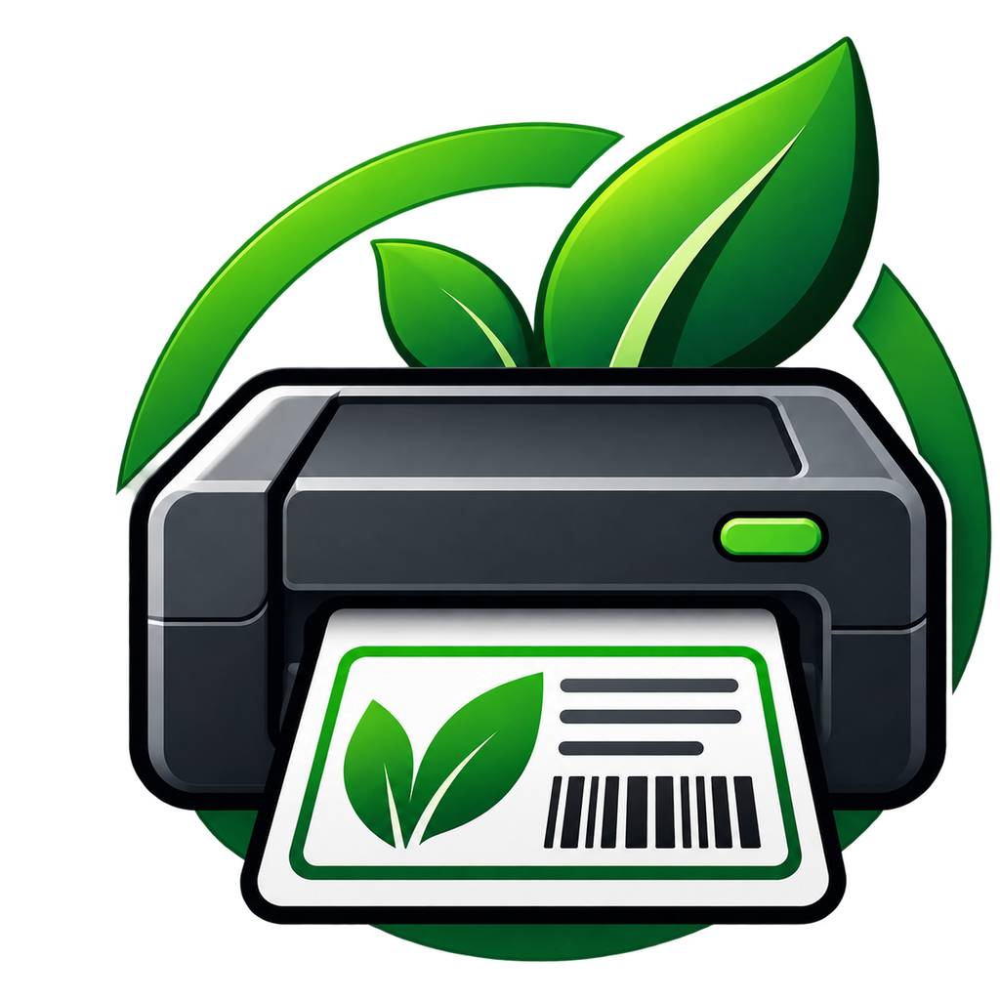

# GreenUp Label Printer

**A desktop application for designing, previewing and printing labels using Citizen label printers.**

  

  <strong>Design. Preview. Print.</strong>

## Overview

GreenUp Label Printer is a Windows desktop application developed to simplify label creation and printing.

It provides two approaches to label design: a graphical template editor and a direct ZPL editor. Both offer a preview before sending the print job to the printer.

The application is designed to work with network-connected Citizen label printers.

## Features

### Graphical Template Editor
- Create labels using a visual editor.
- Add and position text, barcodes, QR codes, rectangles and lines.
- Configure element properties and dimensions.
- Use dynamic data fields.
- Save and reuse custom templates.

### ZPL Editor
- Write and edit ZPL commands directly.
- Preview ZPL labels before printing.
- Generate labels using custom ZPL code.

### Print Management
- Print directly to a network-connected printer.
- Communicate over TCP/IP.
- Configure printer connection settings.
- Print using graphical templates or custom ZPL.

### Template Management
- Store templates locally.
- Create and edit custom templates.
- Reuse templates without modifying the application installation.
- Keep user templates
